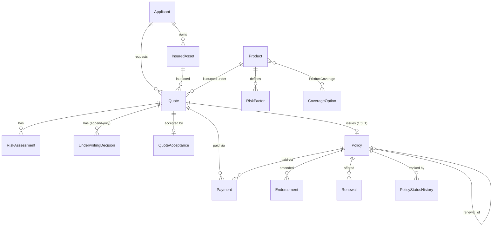

# Database Schema, Relationships & Lifecycles

Source of truth: `backend/app/models/entities.py` (SQLAlchemy 2.0). 25 tables; works on SQLite and PostgreSQL. IDs are deterministic strings from `services/ids.py` (counter table `id_counters`).

## ER overview

## Entities
| Table | PK (format) | Foreign keys | Cardinality / notes |
|---|---|---|---|
| applicants | `APP-2026-000001` | - | `owner_key` isolates demo customers |
| insured_assets | `AST-2026-000001` | applicant_id | Applicant 1:N Asset; type-specific data in `attributes` JSON |
| products | `PROD-001..003` | - | effective_from/to |
| coverage_options | `COV-001..009` | - | limits + rate multiplier |
| product_coverages | (product_id, coverage_id) | both | bridge, N:M |
| risk_factors | `RSK-001..017` | product_id | weights mirror config |
| approval_authorities | `AUTH-<PRODUCT>-<LEVEL>` | product_id | seeded from config |
| quotes | `QTE-2026-000001` | applicant, asset, product, coverage (nullable) | stores eligibility detail, risk, premium breakdown, input snapshot |
| quote_coverages | (quote_id, coverage_id) | both | bridge |
| risk_assessments | `RAS-2026-000001` | quote_id | one per evaluation (re-evaluation appends) |
| underwriting_decisions | `UWD-2026-000001` | quote_id | **append-only**, unique (quote_id, sequence); current = max sequence |
| quote_acceptances | `ACC-2026-000001` | quote_id (unique) | explicit acceptance + terms version |
| payments | `PAY-2026-000001` | quote_id?, policy_id? | DEMO only; `idempotency_key` unique blocks duplicates |
| policies | `POL-2026-000001` | quote_id (unique, nullable), applicant, asset, product, coverage, renewal_of_policy_id | Quote 1:0..1 Policy; immutable `snapshot` |
| policy_coverages | (policy_id, coverage_id) | both | bridge |
| policy_status_history | autoinc int | policy_id | every transition |
| endorsements | `END-<policy-id>-001` | policy_id | stores before/after, policy snapshot, decision |
| renewals | `REN-<policy-id>-2027` | policy_id, new_policy_id | unique (policy_id, renewal_year) |
| audit_events | `AUD-2026-000001` | - (entity_type/entity_id polymorphic) | append-only |
| ground_truth | `GT-000001` | - | **evaluation only**, never read by engines |
| id_counters | key | - | deterministic ID source |
| dataset_runs | `GEN-001` | - | **run metadata** (seed, scale, status, row counts, checksums); not part of the deterministic dataset |
| validation_runs | `VAL-001` | - | run metadata: per-check results, business metrics, ground-truth evaluation |
| detected_exceptions | `EXC-VAL-001-00001` | run_id → validation_runs | detector findings with severity, record date, expected/actual outcome, resolution workflow (OPEN/ACKNOWLEDGED/RESOLVED) |
| ai_interactions | `AIX-000001` | - | append-only copilot interaction log (actor, intent, provider, model, latency, used_fallback, question hash); run metadata (in `NON_DATASET`) |

## Lifecycle states
- **Quote:** `PENDING_INFORMATION | REFERRED | APPROVED | DECLINED` (from decision) → `ACCEPTED` → `POLICY_ISSUED`; `EXPIRED` reserved for validity lapse.
- **UnderwritingDecision.outcome:** APPROVED, REFERRED, DECLINED, PENDING_INFORMATION (type AUTOMATED | MANUAL).
- **Policy:** `DRAFT→PENDING_ACCEPTANCE→PENDING_PAYMENT→ACTIVE→{CANCELLED, EXPIRED, RENEWED}`; `EXPIRED→RENEWED`. CANCELLED and RENEWED are terminal. Rows start ACTIVE (issuance guard).
- **Payment:** SUCCESS | FAILED | PENDING (PENDING → SUCCESS/FAILED).
- **Endorsement:** PENDING → APPROVED | REJECTED (limit breach auto-REJECTED).
- **Renewal:** OFFERED → ACCEPTED | DECLINED | (EXPIRED reserved); CANCELLED = withheld/withdrawn. GENERATED reserved for batch mode.

## Effective dates
Product/ProductCoverage `effective_from/to`; Policy `start_date`/`expiry_date` (term = 1 year, expiry = start + 1y − 1d); Endorsement `effective_date` must fall within the policy period; Renewal `new_start_date = expiry + 1 day`.

## Migrations & dictionary
Alembic: `0001_baseline_schema` (21 tables), `0002_run_metadata_exceptions_ground_truth_category` (+3 tables, `ground_truth.record_category`), `0003_ai_interaction_table` (+1 table `ai_interactions`, index on `created_at`). Field-level dictionary: `docs/DATA_DICTIONARY.md` (generated). `ground_truth.record_category` ∈ ANOMALY | EDGE_CASE.
